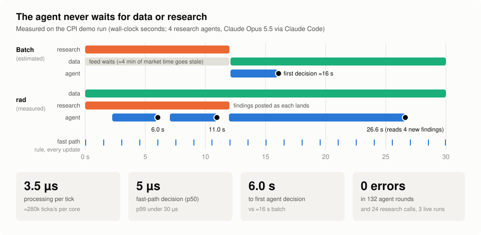
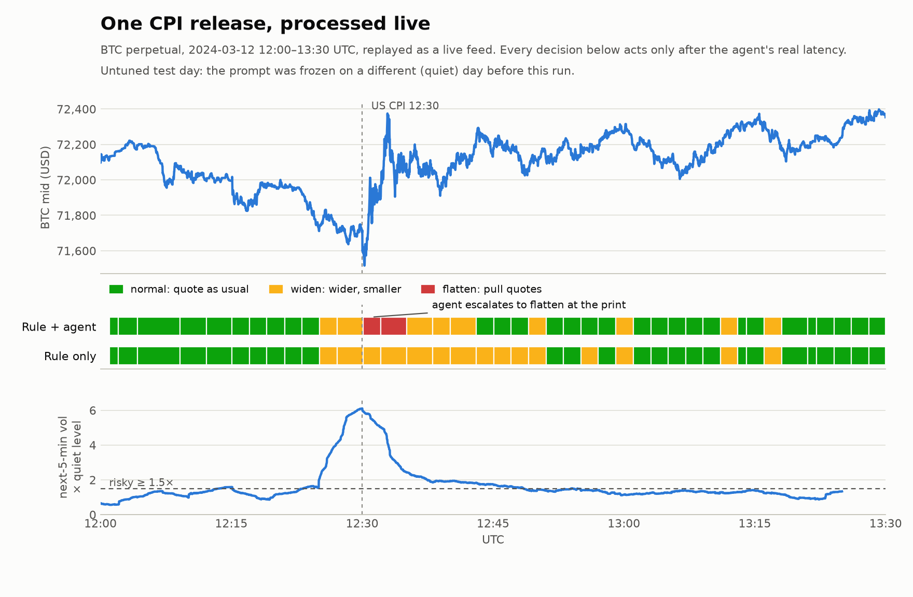

# rad: concurrent data collection + processing for running agents

Most agent pipelines work in barriers: collect the data, wait for the slowest research call, then let the agent think. By the time it decides, the data is stale.

**rad** runs data collection, processing, background research and your agent **at the same time**. The agent always reads fresh, already-processed data. A deterministic fast path keeps a decision current between agent calls, and research findings arrive while the agent keeps working.

<p align="center"></p>

**What your agent does with the data is up to you.** rad is the data layer. The trading demo below is one example consumer, not the product.

## Results from the demo
The demo streams one CPI day of Binance BTC/ETH/SOL perpetual data, at 100 ms resolution, through rad and into a live Claude agent (Opus 5.5). All numbers come from live runs recorded in `runs/`.

**Data layer (the product)**
| | |
|---|---|
| Processing cost | **3.5 µs per tick**: about 280k ticks/s per core, with O(1) recursive features computed off the event loop |
| Fast-path decision | **5 µs** p50, under 30 µs p99, on every update |
| Time to first agent decision | **6.0 s** with 4 research agents running alongside, vs about 16 s if the agent waited for research. This was measured before agent construction moved off the event loop; setup is now reported on its own line and no longer delays the data path |
| Freshness | each agent round reads the newest snapshot plus only what's new since its last read; no backlog, no polling |
| Reliability | **0 errors** in 132 agent rounds and 24 research calls across 3 live runs |

**Demo consumer on the CPI release** (test day; the prompt was frozen on a different, quiet day first)

<picture>
  <source media="(prefers-color-scheme: dark)" srcset="docs/results-dark.png">
  
</picture>

| Policy | Caught risky windows | Precision | Flatten calls before ≥ 3x vol moves |
|---|---|---|---|
| rule alone (fast path) | 72% | 70% | none (it can't) |
| rule + agent | 56% | 78% | **4 of 4**, each followed by a 68–170 bps move |

- **Where the agent added value:** it recognized the print as it landed and pulled quotes on all three symbols right before the day's biggest moves.
- **Where it hurt:** it stood down too early afterwards, which cost recall.
- This was one pre-registered test. The full protocol and run log, including what failed, are in [`docs/EVALUATION.md`](docs/EVALUATION.md).

## What you get
| Piece | What it does |
|---|---|
| **Blackboard** (`rad/blackboard.py`) | Shared state with two semantics. Snapshots are **last-value-wins**, so readers never work through a backlog. A log is **append-only with cursors**, so each reader gets only what's new. Writers wake readers; nothing polls. |
| **Sources** (yours, or `rad/plugins/`) | Any `async def source(bb)` that publishes. The bundled market plugin turns an L1 book into spread, vol vs a reference, an order-flow pressure index and its derivatives. |
| **Fast path** (`Consumer.fast`) | Your deterministic function, run on every update, so a current decision always exists at data speed. |
| **Consumer agent** (`Consumer` + a swarms `Agent`) | Wakes on any change (debounced). It reads the freshest snapshot, only the new log entries and new research. It returns text that your `parse` turns into a decision, and your `combine` merges that with the fast path. |
| **Research pool** | N swarms Agents answer questions from a queue. You seed the queue, and your agent adds to it mid-run. Each finding is posted the moment it's done. |
| **LLM backends** (`rad/claude_llm.py`) | `ClaudeLLM` uses the Anthropic SDK with adaptive thinking, effort, server-side refusal fallback and optional web search. `ClaudeCodeLLM` runs headless `claude -p` on a Claude Code login with no API key. `FakeLLM` is for offline tests. All three plug into swarms as `Agent(llm=...)`. |
| **Pipeline metrics** (`Stats.report`) | Time to first decision, data age at read, fast-path latency, µs per tick, capacity, and research latency. |

## Quickstart (no data, no API key)
```bash
uv venv -p 3.12 .venv && uv pip install -p .venv -e ".[demo,dev]"
.venv/bin/python examples/quickstart.py      # synthetic sensor source + offline LLM, about 8 s
.venv/bin/python -m pytest -q tests          # smoke tests
```
Add `--claude-code` (uses a Claude Code login) or `--live` (uses `ANTHROPIC_API_KEY`) to run the quickstart's agents on Claude.

## Use it
```python
import asyncio
from rad import Consumer, ClaudeLLM, run

consumer = Consumer(
    name="my-agent",
    system_prompt="...",
    render=lambda r: f"{r.context}\nlatest: {r.latest}\nnew: {r.new}\nresearch: {r.findings}",
    parse=lambda text: {"answer": text} if text else None,   # your decision format; None rejects
    fast=lambda latest: {...},                               # optional: runs on every update
    combine=lambda fast, agent: {...},                       # optional: merge fast + agent
    questions=lambda text: [],                               # optional: follow-up research
)
stats, bb = asyncio.run(run(
    sources=[my_source],                                     # async def my_source(bb): bb.put_latest(...); bb.append(...)
    consumer=consumer,
    llm_factory=lambda role, system: ClaudeLLM(system=system),
    seed_questions=["..."],
))
print(stats.report(bb))
```
Sources that put `ts_ms` (event time) in their payloads get event-time tracking automatically.

## Run the trading demo
The demo needs your own 100 ms L1 grid per day at `$RAD_DATA_DIR/<day>/grid_100ms.parquet` (or `.pkl`). It needs columns `{btc,eth,sol}_{bid,bidq,ask,askq,ofi,signed_vol}`, indexed by `ts_ms`. Only load pickles you created yourself: unpickling runs code.
```bash
uv venv -p 3.12 .venv && uv pip install -p .venv -r requirements.txt
export ANTHROPIC_API_KEY=sk-ant-...                     # or pass --claude-code to use a Claude Code login
export RAD_DATA_DIR=/path/to/data                       # folders <day>/grid_100ms.pkl (100 ms L1 grid)
.venv/bin/python examples/trading_risk_demo.py --day 2024-03-11 --web   # quiet control day
.venv/bin/python examples/trading_risk_demo.py --day 2024-03-12 --web   # CPI day
.venv/bin/python examples/trading_risk_demo.py --dry-run                # no LLM
```
Set `RAD_MODEL` to change the model. `docs/make_figures.py` re-renders the results chart from a saved run.

## Notes
- **Swarms telemetry is on by default.** It sends each agent's request and response to telemetry.swarms.world. rad sets `SWARMS_TELEMETRY_ON=false` before importing swarms. Keep it off for anything proprietary.
- **`ClaudeCodeLLM`:** each call starts a fresh `claude -p` with no tools (or only WebSearch/WebFetch), no MCP servers and no settings, from the temp dir. It uses the caller's Claude plan and adds about 2 s of process start-up per call. Use `ClaudeLLM` with an API key for production latency.
- **Going live:** a real-time source replaces the demo's replay loop with a websocket reader that calls the same processing function per batch. Nothing downstream changes.
- **Replay speed:** the demo replays at 20x, so an 8 s agent call would cost 160 s of market time. Decisions are scored at their real (1x) latency instead.
- **Not financial advice.** The trading demo shows how to consume the data layer, not a strategy.

## License
Proprietary; see [`LICENSE`](LICENSE). The source is visible for evaluation. Commercial, production or marketplace use requires a license from the author.
